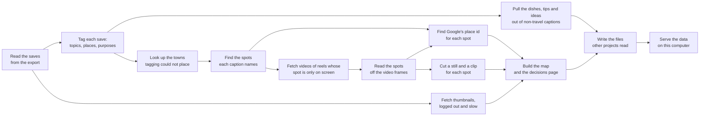
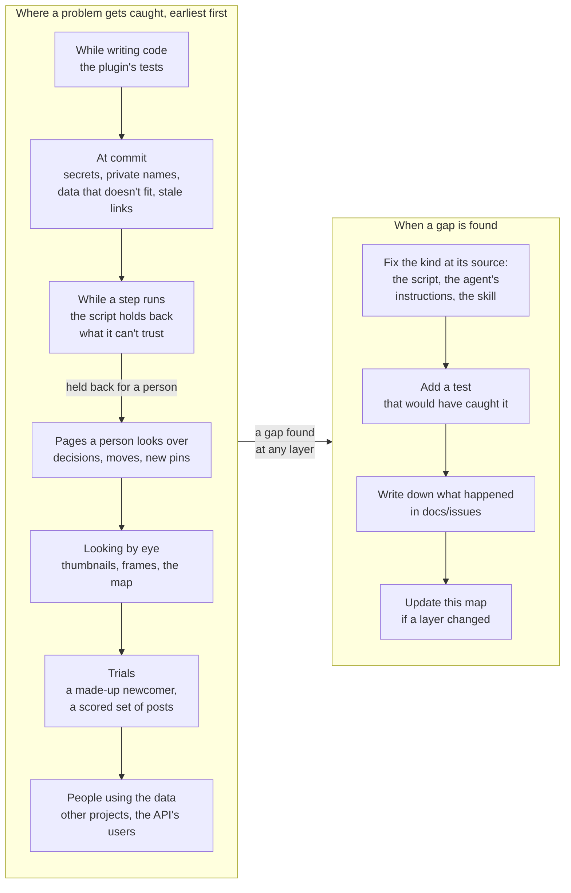

<!-- code-pointers: checked -->
# How the saves become a map, and where problems get caught

Two pictures and a table. The first shows the steps from an Instagram export to the map and the
files other projects read. The second shows the places a problem can be caught, from a test that
fails while the code is written to someone using the data, and what we do at each one. The table
under each picture links every box to the code behind it.

The links are checked at every commit to this repo (`scripts/check-code-pointers.py`, run by the
pre-commit hook and by `make check-code-pointers`). A rename or move that leaves a link pointing
at nothing stops the commit; `make check-code-pointers FIX=1` repoints the links whose new home is
clear, and names the rest for a person to fix.

## 1. The steps

| Box | Command | Code |
|---|---|---|
| Read the saves | `make import` | [main](../skills/import-saves/scripts/import_saved.py#main), and the list of names that must never go public: [never_public](../skills/import-saves/scripts/import_saved.py#never_public) |
| Tag each save | `make tag-prepare`, agents, `make tag-merge` | [prepare](../skills/tag-saves/scripts/tag_saves.py#prepare), [merge](../skills/tag-saves/scripts/tag_saves.py#merge), the agent: [save-tagger](../agents/save-tagger.md) |
| Look up the towns | `make places` | [main](../skills/tag-saves/scripts/add_places.py#main) |
| Pull out dishes, tips, ideas | `make split-prepare`, agents, `make split-merge` | [prepare](../skills/split-saves/scripts/split_saves.py#prepare), [merge](../skills/split-saves/scripts/split_saves.py#merge), the agent: [save-splitter](../agents/save-splitter.md) |
| Find the spots | `make locate-prepare`, agents, `make locate-merge` | [prepare](../skills/resolve-post-location/scripts/resolve_post_location.py#prepare), [merge](../skills/resolve-post-location/scripts/resolve_post_location.py#merge), [resolve](../skills/resolve-post-location/scripts/resolve_post_location.py#resolve), the agent: [post-locator](../agents/post-locator.md) |
| Fetch thumbnails and videos | `make media-trial`, `make media-video` | [main](../skills/fetch-media/scripts/fetch_media.py#main) |
| Read spots off the frames | `make frames-stuck`, `make frames`, agents, `make frames-merge` | [stuck](../skills/read-frames/scripts/read_frames.py#stuck), [prepare](../skills/read-frames/scripts/read_frames.py#prepare), the agent: [frame-reader](../agents/frame-reader.md) |
| Cut stills and clips | `make stills` | [main](../skills/extract-stills/scripts/extract_stills.py#main) |
| Google's place ids | `make google-ids` | [main](../skills/find-google-ids/scripts/google_ids.py#main), [choose](../skills/find-google-ids/scripts/google_ids.py#choose) |
| Build the map | `make hub` | [build](../skills/build-hub/scripts/build_hub.py#build), [placed_spots](../skills/build-hub/scripts/build_hub.py#placed_spots) |
| Files for other projects | `make send-topics` | [main](../skills/send-topics/scripts/send_topics.py#main) |
| Serve the data | `make api` | [build](../skills/serve-api/scripts/api.py#build), the contract: [contract.py](../skills/serve-api/scripts/contract.py) |

Every command is a target in [the example Makefile](../examples/Makefile#help).

## 2. Where problems get caught

Each layer catches what the one before it can't. The earlier a problem is caught, the cheaper it
is, so when a later layer catches something, the fix usually goes in an earlier one.

| Layer | What it catches | What we do | Code |
|---|---|---|---|
| While writing code | a change that breaks a step | fix it before committing | `make test`; each script has a `test_*.py` beside it |
| At commit | secrets; real names, handles and post codes in this public plugin; data files that don't fit together; a doc link left pointing at code that moved | the commit stops until it's fixed | [the never-public check](../../../scripts/check-never-public.sh), [the data check](../shared/scripts/check_data.py#check) and its [list of problems](../shared/scripts/check_data.py#problems), [the link check](../../../scripts/check-code-pointers.py#main) |
| While a step runs | a quote that isn't in the caption; a spot not found near its town; a spot the caption puts in another town; Instagram slowing us down; Google offering only a chain or nothing close | the script keeps what it trusts and holds the rest back for a person, or stops the run | [quote_ok](../shared/scripts/quote.py#quote_ok), [wrong_area](../skills/resolve-post-location/scripts/resolve_post_location.py#wrong_area), [LOOKUP_MISSES](../skills/build-hub/scripts/build_hub.py#LOOKUP_MISSES), [really_elsewhere](../skills/build-hub/scripts/build_hub.py#really_elsewhere), [stop_signal](../skills/fetch-media/scripts/fetch_media.py#stop_signal), [too_soon](../skills/fetch-media/scripts/fetch_media.py#too_soon), [choose](../skills/find-google-ids/scripts/google_ids.py#choose), [SHOW_CHARS](../skills/find-google-ids/scripts/google_ids.py#SHOW_CHARS) |
| Pages a person looks over | what was held back: spots to check, Google picks, saves filed in the wrong collection, new pins | a person decides on the page; the next run applies it | [the decisions page](../skills/build-hub/scripts/decisions_page.py#build) and its [held-back spots](../skills/build-hub/scripts/decisions_page.py#open_review), [the moves page](../skills/tag-saves/scripts/moves_page.py#page), [the new-pins page](../skills/resolve-post-location/scripts/pins_page.py#build), [saves in the wrong collection](../skills/tag-saves/scripts/tag_saves.py#misfiled) |
| Looking by eye | a blank thumbnail, text misread off a frame, a pin in the sea, a page that renders wrong | open a sample and compare; fix the step that made it | the build-hub, extract-stills and read-frames skills say what to look at |
| Trials | a newcomer stuck on a step; the post-locator getting worse after a change; agents given too much to read | fix the docs, the agent's instructions or the batch size | [the trial sandbox](../skills/new-user-trial/scripts/make_sandbox.py#main), the [tester](../agents/new-user-tester.md) and [reviewer](../agents/trial-reviewer.md), [the locator's score](../skills/resolve-post-location/scripts/check_locator.py#score), [how the agents did](../skills/tag-saves/scripts/batch_review.py#suggest) |
| People using the data | a field another project needed, an API answer that confused someone | they leave a note; we read the notes before changing the API | the data repo's `docs/api-feedback/`; comments left on the hub's pages |

## 3. Gaps found, and where they were fixed

The newest first. Each has a longer write-up in the data repo's `docs/issues/`.

| Gap | Caught at | Fixed at |
|---|---|---|
| A spot whose caption names only a state or country sat among thousands of rows nobody reads | looking by eye at the Google run | the decisions page lists it under "spots to check": [open_review](../skills/build-hub/scripts/decisions_page.py#open_review) |
| A long Google run printed so much that the tool running it saved Google's names to a file, which the rules forbid | looking by eye at the session folder | the printout stops at [SHOW_CHARS](../skills/find-google-ids/scripts/google_ids.py#SHOW_CHARS) and names the rest |
| "Really in Example Town" held back a spot already filed under Example Town | the Google run's count of held-back spots | one test for "another town" used everywhere: [really_elsewhere](../skills/build-hub/scripts/build_hub.py#really_elsewhere) |
| OpenStreetMap doesn't know an area, so nothing can be filed there | the Google run | the resolve-post-location skill: use the nearest town it knows, with a wide box |

## 4. Gaps still open

- **Links from the data repo's docs into this plugin aren't checked.** Only docs in this repo are.
  A refactor here can leave a stale path in the data repo's notes.
- **`scripts/check-skill-refs.py` isn't run at commit.** It is run by hand.
- **Notes from people using the data are read by hand.** Nothing counts how many gaps each layer
  catches, so we can't yet see which layer is weakest.
