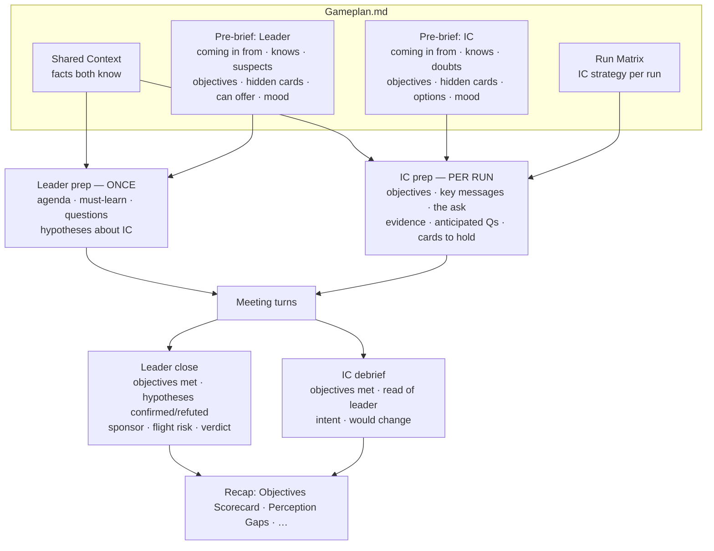
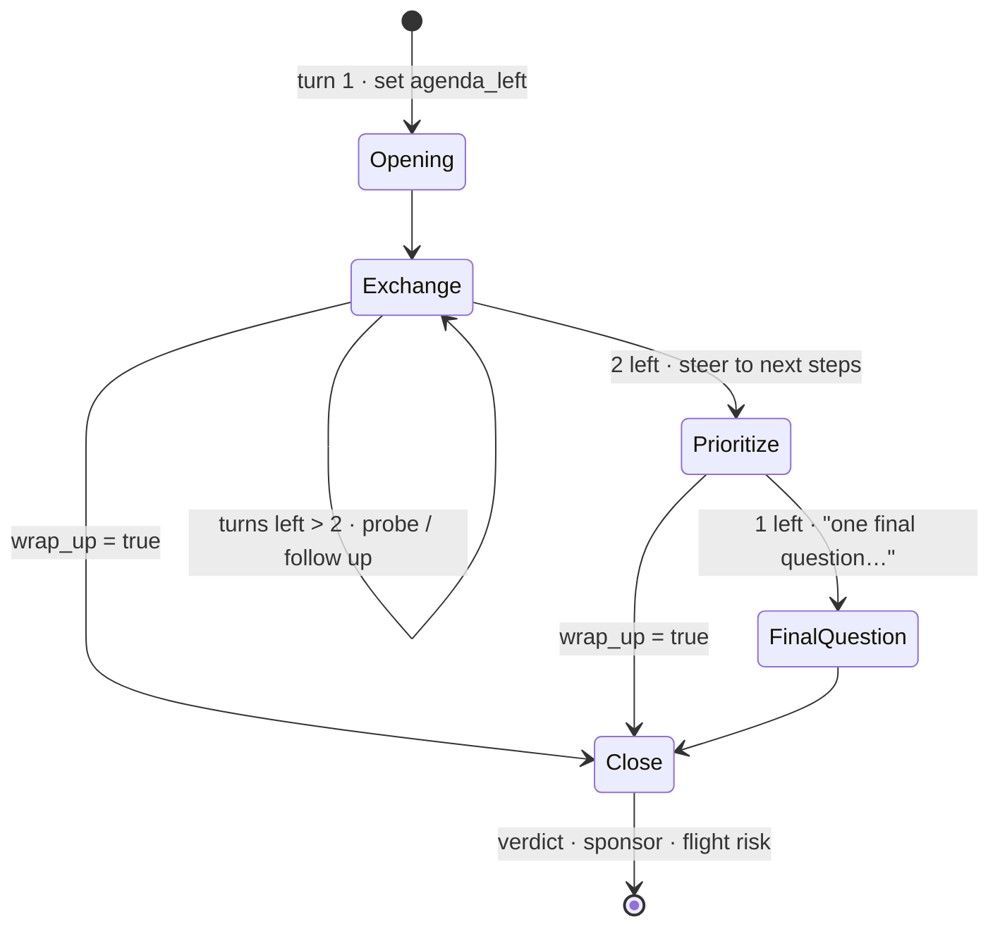
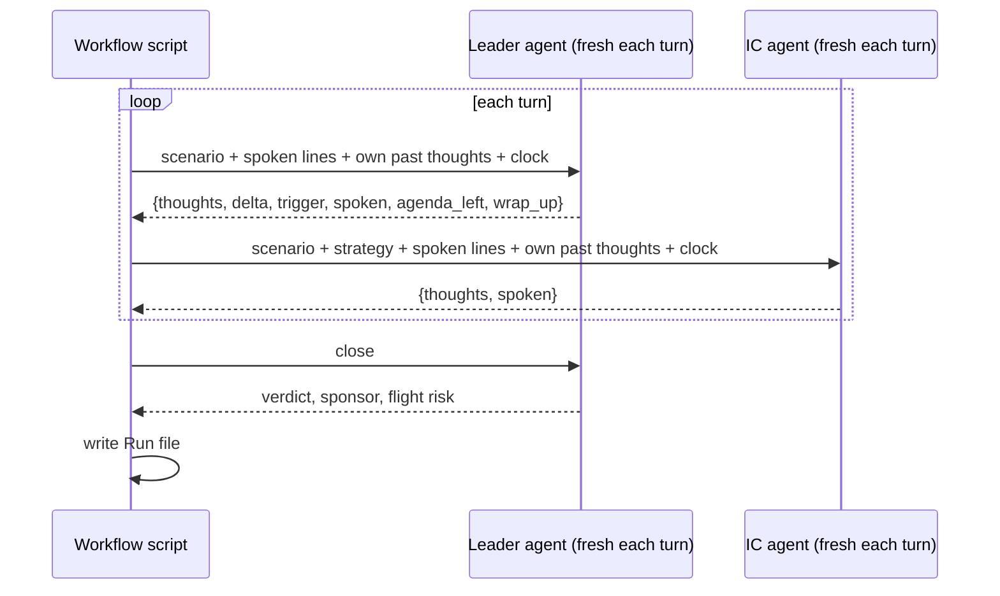
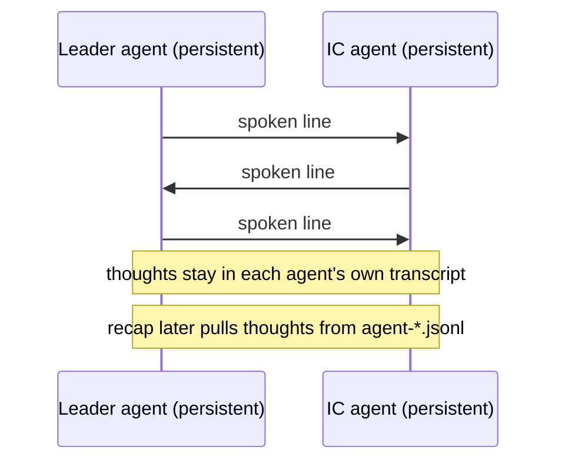
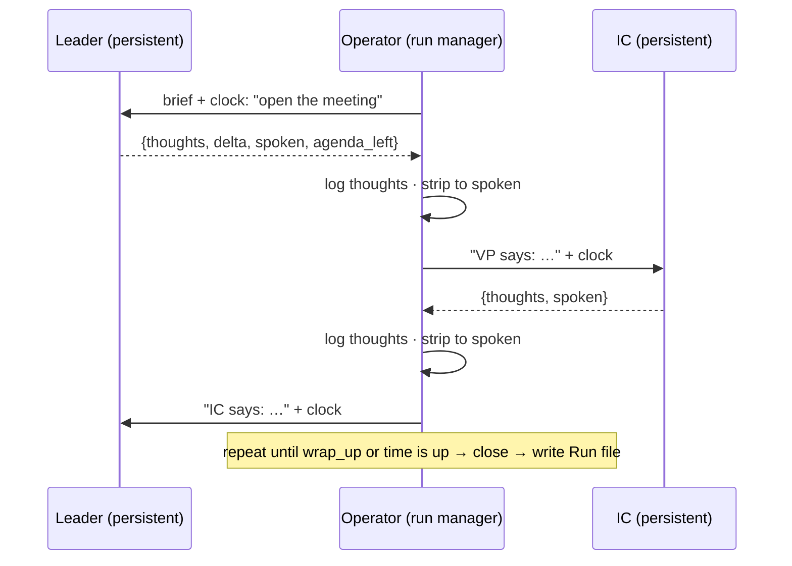
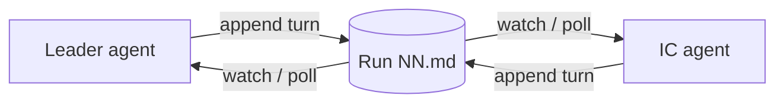
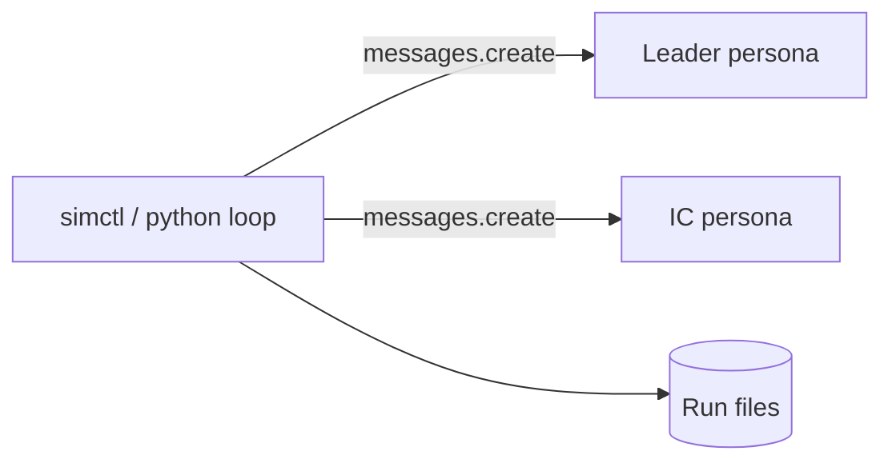
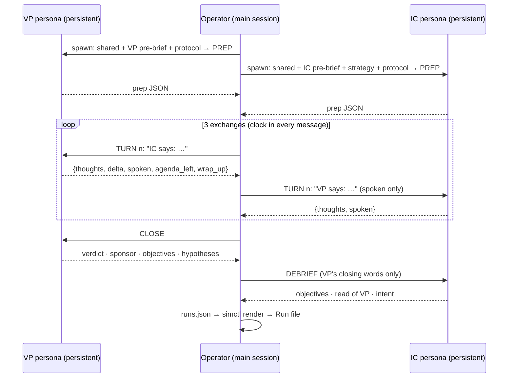
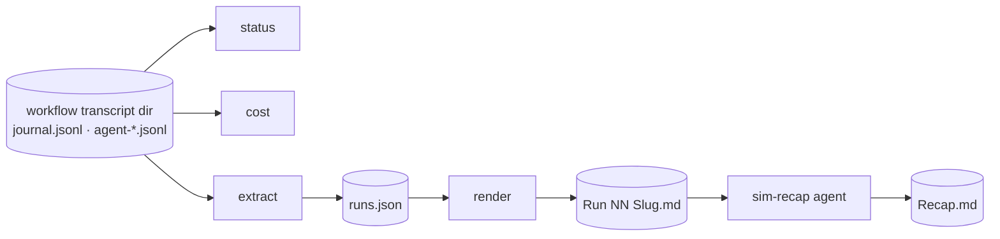

# Simulation Manager — Design

How multi-run leader ↔ IC meeting simulations work, and why they're built this way.

## Goal

Stress-test an upcoming meeting (e.g. a VP skip-level 1-1) by running the same scenario N times. In each run the IC plays a different strategy. Each run records what the leader **privately thinks** after every IC line, and how much it moved their impression. Then compare the runs: which moments impressed, which hurt, where the outcomes split, and which questions to prepare for.

## Naming

The skills are generic and use the roles **VP persona** and **IC persona**. A real name ("Doug") belongs to one **instance**: it lives only in that instance's Gameplan and pre-briefs and in the dialogue. Agent descriptions, agent names, and workflow labels always use the role:
- Agents: `VP persona (sim · <Folder> · Run NN <Slug>)`, `IC persona (sim · <Folder> · Run NN <Slug>)`
- Workflow labels: `run 03 Ambition-First · VP 2`, `· IC 2`, `· close`, `· IC prep`, `· IC debrief`, `prep · VP`

## Skill Family

| Piece | Type | Role |
|---|---|---|
| `vp-simulator` | skill + agent | One-shot prep brief from the leader's POV, plus one scripted ideal-scenario conversation (ask A → options 1/2/3) |
| `ic-simulator` | skill + agent | The same from the IC's POV (leader-prep or rehearsal mode) |
| `simulate-conversation` | skill | **Entry point**: intake interview → Gameplan with pre-briefs → picks the engine (operator for 1–3 runs, workflow for 4+) → recap |
| `simulation-manager` | skill | Engine room: gathers the scenario, writes Gameplan.md, confirms the run matrix, launches the workflow, closes out |
| `operator-protocol.md` | protocol | Operator mode (option C): persona prompt templates + relay loop |
| `simulate-conversations.workflow.js` | workflow script | The engine: runs the turn loops, writes the run files, runs the recap |
| `sim-recap` | agent | Re-runs or refreshes the recap on an existing simulation folder |

`vp-simulator` / `ic-simulator` give you **one author's ideal script**. `simulation-manager` gives you **N independent conversations**, where the leader reacts without knowing the IC's strategy. Use the first for a quick brief and the second for evidence.

## Flow

```
User prompt
  │
  ▼
simulation-manager (main session)
  1. gather scenario (reuse vp/ic-simulator brief, meeting notes)
  2. create  Notes/📽️ Simulations/📽️ YYMMDD <Title>/
  3. write   Gameplan.md  (scenario, personas, objectives, run matrix, scoring)
  4. confirm run matrix + cost with user  ← cost gate / opt-in
  5. launch Workflow(simulate-conversations.workflow.js, args)
  │
  ▼
Workflow (background)
  pipeline over runs ─┬─ Run 01: turn loop → write "Run 01 <Slug>.md"
                      ├─ Run 02: turn loop → write "Run 02 <Slug>.md"
                      └─ … (runs execute concurrently)
  then (barrier) recap agent → Recap.md
  │
  ▼
simulation-manager close-out: fill Gameplan ## Results; meeting note gets an Exec Summary (arc, must-ask, If ___ → Do ___ playbook) on top, with the detailed prep under ## Archive; report
```

## Pre-work: Pre-briefs → Prep → Meeting → Debriefs

Real people walk into a meeting with **different information and their own prep**. Each run has four stages:



- **Shared vs private**: anything only one person knows goes in their own pre-brief. What the leader only *suspects* (e.g. "might be talking to product") is a suspicion in the leader's brief; the fact (e.g. "product's director pinged me") is a hidden card in the IC's brief
- **The leader preps once and every run uses that prep**: every run starts from the same VP, so differences between runs come from the IC strategy, not from leader variance. It's also cheaper
- **The IC preps per run**: the prep follows the strategy (Data-Driven brings numbers; Cautious lists more cards to hold)
- **Prep drives the meeting**: the leader's starting `agenda_left` comes from their prep agenda, and the IC's prep includes the ask and when to make it
- **Debriefs close the loop**: both sides score their own prep objectives (✅ / 🟡 / ❌ with evidence). The recap compares the IC's read of the leader against the leader's actual verdict (**perception gaps**)
- Outputs: `Prep <Leader>.md` (once), and in each run file an `## IC Prep` section at the top and a `## Debriefs` section at the bottom

## Turn Loop (per run)

The script is the **referee**. Agents never talk to each other directly, and they never read or write a shared file during the conversation. The script holds the transcript in memory and builds each agent's prompt from it.

```
t = []                                   # in-memory transcript
repeat maxTurns (default 6), or until the leader sets wrap_up:
  Leader agent  ← shared + leader pre-brief + leader prep + spoken lines + own past thoughts + clock + agenda_left
                → { private_thoughts, impression_delta (-2..+2), trigger, spoken, agenda_left, wrap_up }
  IC agent      ← shared + IC pre-brief + THIS RUN'S STRATEGY + IC prep + spoken lines + own past thoughts + clock
                → { private_thoughts, spoken }
Leader close    → { …, would_sponsor, flight_risk, verdict, best/worst moment, objectives_met, hypotheses_result }
IC debrief      → { objectives_met, read_of_leader, intent, would_change }
score = Σ impression_delta
```

- Every turn is a **fresh, stateless agent**. The character is rebuilt from the prompt each time (one run = 6 + 6 + 1 = 13 agents)
- Every turn returns **structured output** (JSON schema), so the recap works on clean fields instead of scraping transcripts
- `impression_delta` is the leader's reaction to the IC's **previous** line. On the opening turn it is forced to 0

### Information Walls

| | Leader sees | IC sees |
|---|---|---|
| Shared context | ✅ | ✅ |
| Leader pre-brief + leader prep | ✅ | ❌ |
| IC pre-brief + IC prep | ❌ | ✅ |
| Run matrix / IC strategy | ❌ | ✅ (own run only) |
| Spoken lines | ✅ | ✅ |
| Own past thoughts | ✅ | ✅ |
| Other side's thoughts | ❌ | ❌ |

The leader not knowing the strategy is the point of the design. It keeps the leader's reactions real signals instead of performances. The skill passes Gameplan sections as separate args (`shared`, `leaderBrief`, `icBrief`, `runs`), and the script decides which prompt gets which.

## Meeting Clock & Pacing

Real 1-1s are time-boxed, so both sides see a clock. `durationMin` (default 30) is spread across `maxTurns` exchanges plus the close.

- **Leader agenda**: on the opening turn the leader sets `agenda_left`, a ranked list of priorities. Each later turn they update it and drop what time no longer allows. The run file shows it as `📋 Agenda left:`
- **Clock cues** in every prompt: `~X min elapsed, ~Y left (N exchanges before closing)`
  - 2 exchanges left → "prioritize what matters most; start steering toward next steps"
  - last exchange → "e.g. 'one final question…'"
- **Early wrap-up**: the leader sets `wrap_up: true` once they have what they need (after turn 2). The script skips to the close
- **IC sees the clock too**: "if time is nearly up and you haven't made your ask, make it now"
- Turn headings show the minute mark: `### Turn 4 · ~13 min`



## Design Options

How do the leader and IC exchange turns? Five options. The workflow currently implements **A**.

### A. Script referee, one agent per turn (current)

The workflow script holds the transcript in memory and starts a fresh agent for every turn.



- ✅ Information walls enforced in code; deterministic, capped, resumable; runs in parallel
- ❌ Every turn pays the full Claude Code context (~45k tokens/agent measured). 13 agents per run, no persistent character memory

### B. Peer-to-peer: two persistent agents message each other

Spawn one leader agent and one IC agent per run. They `SendMessage` each other directly.



- ✅ 2 agents per run; real persistent memory per character; context is reused through the cache instead of rebuilt
- ❌ The walls depend on the agents behaving: nothing stops one side from leaking its thoughts or strategy. There's no referee to cap length or enforce the clock, and runaway loops are possible. Thoughts have to be scraped from transcripts
- ⚠️ Requires subagents to have `SendMessage` to their peers; this hasn't been verified

### C. Switchboard operator: agents talk only to a run manager (phone operator)

One **operator** per run (or the main session) spawns a persistent leader and a persistent IC. Each side replies only to the operator, with structured output. The operator forwards **only the spoken line** to the other party, keeps the clock, and writes the run file.



- ✅ Walls enforced by the operator (it strips thoughts before forwarding). Persistent characters; agents per run drop from 13 → 3; context is reused through the cache; the operator owns pacing and early wrap-up
- ❌ Workflow scripts can't continue an agent (each `agent()` call is fresh), so the operator must be an LLM agent or the main session. That's less deterministic, and the operator's context grows with every relay. In the main session, 10 runs × ~13 relays floods the context
- ⚠️ Raw token counts drop less than you'd expect: each continued turn still re-reads its whole context. The saving is in **price** (cached reads are ~10% of the cost) and **agent count**, not in raw tokens
- ⚠️ Needs a spike: confirm that a subagent operator can spawn and `SendMessage` its own sub-subagents (nesting depth)

### D. Shared conversation file, agents watch it

Both agents watch a `Run NN.md` file and append their turn when it's their move.



- ✅ You can watch the conversation grow live in NotePlan
- ❌ Both sides read the file, so thoughts and strategy leak unless they're stored elsewhere. Polling wastes turns, read/write collisions are possible, and nobody owns turn order. **Rejected**
- Live viewing is better done as a variant of A or C: only the script/operator appends to the file, and agents never read it

### E. Direct API calls (no Claude Code subagents)

A Python script calls the Messages API with a tiny system prompt per character, using the same referee loop as A.



- ✅ ~2–4k tokens per turn instead of ~45k (about 10× cheaper); persistent per-character message history; deterministic
- ❌ Needs `ANTHROPIC_API_KEY` and API billing; it runs outside Claude Code's subagent tooling. **Deferred by choice (2026-10-01)**

### Comparison

| | A Referee/turn | B Peer-to-peer | C Operator | D Shared file | E Direct API |
|---|---|---|---|---|---|
| Agents per run | 13 | 2 | 3 | 2 | 0 |
| Info walls | code-enforced | trust-based | operator-enforced | leaky | code-enforced |
| Character memory | rebuilt each turn | persistent | persistent | persistent | persistent |
| Pacing / clock owner | script | nobody | operator | nobody | script |
| Deterministic / resumable | ✅ | ❌ | partial | ❌ | ✅ |
| Cost | high | low | medium-low | low | lowest |
| Status | **implemented** (workflow) | rejected (walls) | **PoC validated 2026-10-01** (operator mode) | rejected | deferred |

**Recommendation:** use **C (operator mode)** for 1–3 high-value runs and for interactive "watch it unfold" sessions. Use **A (workflow)** for wide unattended matrices (10+ runs), where parallelism and determinism matter more than cost. See the PoC findings below.

## PoC Findings: Option C, Operator = Main Session (2026-10-01)

**Setup**: one run (Run 03 Ambition-First, the top clean scorer from the A run). The main session acted as the operator. Two persistent Sonnet agents (**VP persona**, **IC persona**) each got shared context + their own pre-brief + the protocol in one spawn prompt. Then: prep → 3 exchanges with a clock → VP close → IC debrief, all relayed with `SendMessage` (resume). Output: `Run 03 Ambition-First Operator.md`, rendered with `simctl render`.



### Cost (measured from agent transcripts)

The price-weighted input uses cache-write = 1.25×, cache-read = 0.1×, base = 1×.

| Call | Cache write | Cache read | Price-weighted input |
|---|---|---|---|
| Spawn + prep (per persona) | ~29.7k | 0 | ~37k |
| Each resumed turn | 0.5–1.2k | 30–33k | **~4.2k** |
| A: each fresh per-turn agent (avg, Run 03) | ~19.6k | ~26k | **~27k** |

| Per run (normalized to 6 exchanges + prep + close + debrief) | A: workflow | C: operator |
|---|---|---|
| Agents spawned | 16 | **2** |
| Model calls | 16 | 16 |
| Raw input tokens | ~720k | ~515k (−30%) |
| **Price-weighted input** | **~430k** | **~140k (≈3× cheaper)** |

- **Measured spike** (3 exchanges): 10 calls, 315k raw, **108k weighted**. The A version of Run 03 (6 exchanges, no prep or debrief) was 595k raw, ~352k weighted
- **Where the saving comes from**: the ~30k Claude Code setup is written to the cache once per persona and then **read** at 10% on every turn. In A, each fresh agent re-writes ~20k of it
- **Raw tokens barely drop**: every resumed turn still re-reads the whole history. The saving is price and agent count, not raw tokens
- **Hidden cost, the operator's own context**: every relay is a main-session round that re-reads the main conversation from cache, so a long main session makes each relay expensive. Run operator mode **early in a fresh session**, or keep relays terse (the operator never echoes JSON back)

### Quality

- **Walls held**: the VP never saw the IC's prep, strategy, or hidden cards. The product-interest card reached the VP only because the IC chose to say it
- **Characters stayed consistent** across turns with real memory. Hypotheses from the VP's prep were explicitly confirmed or refuted at close
- **The clock worked**: the IC planned the ask around the 3-exchange limit; the VP used the last exchange for "one ask" and set `wrap_up`
- **No placeholder or schema problems**: 10/10 replies were valid JSON with real content (vs 23 placeholder fields and 4 failed runs in the A batch)
- **Debrief signal**: the IC flagged that scope clarity was only partly met, and the VP independently scored "position on scope split" as partly met, so there was no perception gap on that point

### Limits

- **Serial by nature**: ~2.3 min wall-clock for 3 exchanges. Ten runs can be interleaved (multiple VP/IC pairs in flight), but each run is a strict ping-pong
- **The operator is an LLM**: relays are copied by hand, so long sessions risk transcription errors. Mitigated by relaying `spoken` verbatim and rendering with `simctl`
- **Not resumable like a workflow**: if the main session dies, persona agents can still be resumed by name, but the operator's place in the loop has to be reconstructed from the last relay

## Varying the Focus per Conversation

Each run gets one **strategy**: a single line describing how the IC plays the meeting. Vary **one thing per run** so you can attribute differences in outcome to the strategy.

Reference example: the run matrix from the first instance (VP = "Doug", skip-level, 2026-10-01):

| Run | Slug | Focus | Purpose |
|---|---|---|---|
| 01 | Scope-First | Proposes the team/product scope split; org-level framing | Tests strategic positioning |
| 02 | Loyalty-First | Commitment to the team; ambition only when asked | Tests the retention signal |
| 03 | Ambition-First | States plainly that he wants to lead, backs it with evidence | Tests the leadership ask |
| 04 | Candid-Product | Volunteers product's interest; staying depends on real scope | Tests candor vs leverage |
| 05 | Team-Credit | Multiplier; credits teammates by name | Tests the "leader of others" signal |
| 06 | Data-Driven | Every answer anchored in impact numbers | Tests evidence vs narrative |
| 07 | Listener | Asks the VP questions, reveals little | Tests curiosity vs having a position |
| 08 | Cautious | Guarded, deflects the product question | Tests the cost of opacity |
| 09 | Transactional | **Control**: uses product interest for title/promo | Calibrates what "hurts" looks like |
| 10 | Anxious | **Control**: leads with worry, seeks reassurance | Calibrates what "hurts" looks like |

Rules:
- The IC plays the strategy **authentically, weaknesses included**, and is told not to drift into a generically perfect answer. Otherwise all runs converge and the comparison tells you nothing
- Include 1–2 **negative controls** so the recap has a baseline for "what hurts"
- Strategy pool to draw from: scope-first, loyalty-first, ambition-first, candid-about-offer, team-credit, data-driven, listener, cautious, transactional (control), anxious (control). Tailor it to the scenario

## Output Layout

```
Notes/📽️ Simulations/📽️ YYMMDD <Title>/
  Gameplan.md          input: scenario, personas, objectives, run matrix, scoring, results
  Run NN <Slug>.md     one back-and-forth file per run
  Prep Sheet.md        ★ primary output: questions they'll ask you + questions to ask them
  Recap.md             cross-run analysis
```

**Run file** (`# Run 01 Scope-First`):
```
**Strategy:** …   **Outcome:** impression +6 · sponsor: yes · flight risk: low
### Turn N
**<Leader name>:** "…"
> 💭 *<Leader name> thinks:* …
> Impression +1 → +3 · trigger: …
**IC:** "…"
> 💭 *IC thinks:* …
### Close   (closing line, final thoughts, best / worst moment)
```

**Recap.md** sections: Leaderboard · What Impressed · What Hurt · Divergence Points · Leader's Thinking Patterns · **Top 5 Questions to Prepare For** (best response, why it lands, what to avoid) · Composite Ideal Script · Recommendations for the Real Meeting.

## Tooling: `scripts/simctl.py`

These are mechanical helpers that read a workflow's transcript dir (`journal.jsonl` + `agent-*.jsonl`) and spend no agents:

| Command | Use |
|---|---|
| `simctl.py latest` | Path of the newest workflow transcript dir |
| `simctl.py status latest` | Per-run progress (turns done, close, file written) and **why** failures failed (pulled from the agent transcript) |
| `simctl.py cost latest` | Token usage by run and role, plus the context-overhead percentage |
| `simctl.py extract latest -o runs.json` | Rebuild every run's transcript, including partial and failed runs |
| `simctl.py render runs.json <sim_folder>` | Write `Run NN <Slug>.md` from runs.json (strategies come from Gameplan.md). Replaces the writer agents and recovers partial runs |



## Cost & Model

Measured on the first instance run (2026-10-01): **~45k input tokens per agent vs ~1.5k output, so 97% is context overhead** (Claude Code system prompt, tools, skills list, CLAUDE.md, memory). The conversation content itself is small.

- Agents ≈ 1 leader prep + `runs × (2 × maxTurns + 4)` (IC prep, turns, close, IC debrief, writer) + 1 recap + 1 prep writer. That's 10 × 6 → ~163, ≈ 5–6M tokens
- Cut agents (no API switch): render run files with `simctl render` instead of writer agents (−10); try option C (13 → 3 per run)
- Above the default workflow size guideline, so invoking the skill and confirming the matrix is the explicit opt-in
- Cheaper option: 5 runs × 5 turns ≈ 61
- **Conversation agents default to Sonnet** (`args.model`). On 2026-10-01, Opus conversation agents were blocked by the `reasoning_extraction` safeguard on every IC turn 1. The recap agent stays on the session model
- Writers run at `effort: 'low'`. They only copy pre-built markdown to disk

## Failure Handling

- A failed turn gets **one retry** (`· retry` label). If the retry also fails, the run is dropped, and `log()` reports how many runs were excluded from the recap
- **Placeholder guard**: text fields have `minLength` (spoken ≥ 20, thoughts/verdict ≥ 60), and prompts forbid placeholder values. On 2026-10-01, Sonnet passed schema validation with `"test"` in 23 fields across 6 runs, which corrupted closes and some turns. `simctl status` flags any short field as `? placeholder`
- Observed on 2026-10-01: Sonnet sometimes gives up on the schema (missing `spoken`), which hit 4 of 10 runs before retries existed. `simctl status` shows the error per failed turn
- Resume after a fix: `Workflow({scriptPath, resumeFromRunId})`. Unchanged agent calls replay from cache
- To diagnose an empty result, read the run's `journal.jsonl` before guessing

## Future Options

- **Option C spike**: switchboard operator with persistent characters (see Design Options)
- **Live run files**: the script appends each turn to its run file as it happens (only the script writes; agents still don't read it)
- **Leader temperament variants**: vary the leader (skeptical, rushed, warm) as well as the IC strategy, for a 2-D matrix
- **Repeat runs per strategy**: 2–3 runs per strategy to separate signal from sampling noise
- **IC-side scoring**: also record how the IC's trust in the leader moves, for leader-prep mode
